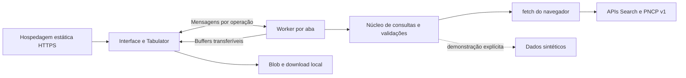

# Arquitetura e organização do código

O Contratos Web é uma aplicação estática. Um Web Worker por aba valida entradas, consulta diretamente as APIs do PNCP e gera CSV. A hospedagem entrega os arquivos compilados; Node.js, Vite e Playwright são ferramentas de desenvolvimento, build e testes.

## Componentes

| Arquivo | Responsabilidade |
| --- | --- |
| [`src/settings.js`](../src/settings.js) | Padrões e validação de configuração portável; whitelist pública |
| [`src/operation.js`](../src/operation.js) | Operações, cancelamento, prazo absoluto e contadores de recursos |
| [`src/validation.js`](../src/validation.js) | Consultas, filtros, domínios, sugestões, identidades e paginação; valida antes da rede no Worker |
| [`src/schema.js`](../src/schema.js), [`src/pncp-arguments.json`](../src/pncp-arguments.json) e [`src/filter-domains.js`](../src/filter-domains.js) | Colunas, 80 filtros, compatibilidade documental, domínios e apresentação |
| [`src/pncp-core.js`](../src/pncp-core.js) | Serialização, fila, ritmo, tentativas, leitura incremental, normalização e caminhos PNCP |
| [`src/query-core.js`](../src/query-core.js) | Pesquisa, validação de domínios, metadados, detalhes e coleta por páginas |
| [`src/csv.js`](../src/csv.js) | Codificação UTF-8 com BOM, CRLF, escape e orçamento por byte |
| [`src/adapter.js`](../src/adapter.js), [`src/related.js`](../src/related.js), [`src/document-details.js`](../src/document-details.js) | Projeções, precisão, identidades e links seguros para os três tipos e registros filhos |
| [`src/browser/client.js`](../src/browser/client.js) | Configuração pública e transporte fetch nativo sem credenciais |
| [`src/browser/runtime.js`](../src/browser/runtime.js), [`worker.js`](../src/browser/worker.js) | Serviço no Worker, métodos permitidos, operações, progresso, erros serializados e buffers transferíveis |
| [`src/browser/service.js`](../src/browser/service.js), [`protocol.js`](../src/browser/protocol.js) | Ponte por ID, versão, cancelamento local, descarte de respostas tardias e recuperação de falha |
| [`src/browser/filter-options-cache.js`](../src/browser/filter-options-cache.js) | Pré-carregamento dos domínios dos três tipos, cache local com validade de 4 horas, deduplicação e opções dependentes de normativos |
| [`src/browser/query-url.js`](../src/browser/query-url.js) | Leitura e escrita de parâmetros GET, conversão de filtros tipados e validação compartilhada de links de pesquisa |
| [`src/browser/detail-url.js`](../src/browser/detail-url.js) | Identidade documental e aba nos parâmetros GET, com validação por tipo de documento |
| [`public/app.js`](../public/app.js) | Interface inicializada com serviço injetado; DOM, Tabulator, histórico da URL, painéis e download |
| [`public/browser-entry.js`](../public/browser-entry.js) | Bibliotecas locais, configuração pública e inicialização da distribuição estática |
| [`src/demo.js`](../src/demo.js) | Fonte fictícia escolhida explicitamente |
| [`vite.config.js`](../vite.config.js) | Aplicação e diagnóstico, Worker ES module, assets relativos, CSP e saída `dist-browser/` |
| [`test/`](../test/) | Núcleo, DOM, runtime/RPC, layout e build estático no navegador |

Vite e Playwright são ferramentas de desenvolvimento. Tabulator e `lossless-json` são incluídos nos bundles; não há CDN, imports de pacote pendentes ou polyfills de Node.js em produção estática.

## Serviço e fluxo de dados

A interface usa `service.call(method, payload, {signal, onProgress})`. A ponte do navegador confirma a versão e envia `{id, method, payload}` ao Worker. Cada resultado, erro ou progresso pertence ao mesmo ID. O `AbortSignal` permanece na interface e seu evento gera uma mensagem de cancelamento. Dados projetados são objetos simples; decimais e identificadores preservam a representação textual exata.

Os métodos são `schema`, `execute`, `domains`, `suggest`, `details`, `related`, `documentDetails`, `documentRelated`, `contractChild` e `export`. Métodos e campos desconhecidos são rejeitados. Se o Worker falhar, todas as promessas pendentes são rejeitadas; a próxima chamada inicializa um novo Worker. O descarte da página encerra o Worker. Fechar um painel cancela suas operações sem encerrar as demais.

A inicialização obtém o esquema e configura colunas e filtros. O Worker valida os critérios e domínios fechados antes de consultar a fonte. Cada troca de página faz nova chamada. A fila compartilha concorrência e ritmo entre pesquisa, domínios, painéis e CSV. O leitor contabiliza bytes, decodifica o corpo com `TextDecoder` e interpreta JSON com `lossless-json`. A pesquisa confere tipo documental, total e quantidade de registros antes da projeção.

Após receber o esquema, a interface inicia em segundo plano os três domínios de busca, os quatro catálogos auxiliares compartilhados e a enumeração de referência. A pré-carga é sequencial e não espera para inicializar a tabela. O painel reutiliza essas listas, deduplicando chamadas pendentes; fechar os filtros cancela a espera daquele leitor, sem interromper o carregamento compartilhado. Sugestões por texto e a conferência de domínios fechados antes da pesquisa/CSV continuam consultando a fonte.

O modal de filtros renderiza todos os campos habilitados e compatíveis com o tipo documental, agrupados por assunto. Cabeçalho e ações permanecem visíveis enquanto o conteúdo rola. Cada alteração atualiza somente o rascunho; **Aplicar e pesquisar** copia os critérios para a consulta, e cancelar os descarta. Booleanos e enumerações possuem a opção **—**. Campos vazios e listas sem seleção removem critérios, preservando `false` e zero quando informados. Domínios parciais possuem seleção e sugestões independentes por campo, com descarte de respostas antigas. Alterar normativos atualiza os amparos mesmo quando ainda não há amparo selecionado.

Todos os filtros de cardinalidade múltipla usam comboboxes de busca, listas com marcação e etiquetas removíveis. Domínios completos usam as opções em cache e busca local sem distinção de acentos; domínios parciais mantêm as sugestões remotas. Os menus ficam no contêiner `filter-popups`, fora do conteúdo rolável, com posição fixa calculada a partir do campo. A rolagem atualiza essa posição ou fecha o menu se o campo sair da área visível. Apenas um menu permanece aberto; clique externo, perda de foco, Tab e Escape o fecham. As setas e Enter controlam a seleção, com vínculos ARIA entre combobox e listbox.

As ajudas de campos vêm de `help_text` no esquema e complementam os rótulos. Exemplos de preenchimento ficam somente no placeholder, via `input_hint`; descrições técnicas de argumentos não são exibidas como ajuda. A orientação sobre filtros de itens, resultados e fornecedores aparece uma vez, na seção de itens.

Critérios novos começam na primeira página; Atualizar preserva os últimos critérios concluídos e a página. Respostas antigas são descartadas. Falhas identificam e preservam o resultado anterior e desabilitam exportação até a pesquisa concluir novamente.

Antes da primeira consulta, a interface lê a URL e configura tipo documental, colunas, texto, status, filtros, ordenação, página e eventual documento/aba do painel de detalhes. Uma URL inválida mostra um aviso sem executar a busca. Consultas iniciadas, abertura/fechamento do painel e seleção de abas sincronizam os parâmetros com `history.pushState`, preservando caminho, fragmento e parâmetros externos. Inicialização e `popstate` usam `replaceState` para normalizar a URL sem duplicar entradas. Voltar/Avançar restauram a consulta e o painel; só repetem a pesquisa quando seus critérios ou página mudam. Trocar de aba no mesmo documento reutiliza os dados carregados. Rascunhos de filtros não alteram o link.

`detalhe` contém tipo, CNPJ, ano e sequencial nativos; atas também incluem o sequencial da compra. `aba` identifica uma seção compatível com esse tipo. A restauração reutiliza uma linha disponível ou cria uma identificação provisória e consulta `documentDetails`, inclusive para editais. Os campos de edital usam `/api/consulta/v1`; atas, contratos e listagens usam `/api/pncp/v1`. O painel e a busca carregam independentemente: o documento não precisa constar nos resultados, e uma falha da busca não impede seus detalhes. Fechar, trocar o documento ou iniciar nova busca cancela as operações do painel; respostas antigas não mudam a seleção atual.

A paginação remota usa `setPage` para abrir diretamente a página do link. O seletor de ordenação usa `orders_by_document` e `order_labels` do esquema; o Worker e a leitura da URL validam a mesma compatibilidade. O seletor e os menus de colunas enviam critérios nativos ao PNCP; `headerSort: false` desabilita a ordenação própria do Tabulator. Novos critérios reiniciam a página. Atualizar consulta a página da última pesquisa concluída; repetir uma falha usa a página que falhou.

## Painéis dos documentos

O cabeçalho do painel usa o título da linha selecionada. Contratações iniciam itens, arquivos, atas, contratos/empenhos e histórico em segundo plano. Atas iniciam detalhes completos, partes envolvidas, contratos, arquivos e histórico. Contratos iniciam detalhes completos, empenhos, instrumentos de cobrança, termos, arquivos e histórico. Uma fila do painel limita a duas tarefas ativas; abas preservam dados e paginação, contadores, teclado e recuperação independente.

CNPJ, ano e sequenciais são textos validados. Atas preservam sequenciais da compra e da ata; contratos usam seu próprio sequencial. O detalhe completo confere controle PNCP contra a identidade antes de substituir os campos da busca. Falhas conservam os campos disponíveis.

Itens, arquivos, histórico e termos usam contagens separadas; outros recursos usam o total de envelopes paginados. Instrumentos de cobrança chegam numa lista sem paginação e usam `pagination_source: local_slice`. Arquivos de termos e detalhes de empenhos/instrumentos são consultados sob demanda. Arquivos binários permanecem como links seguros da fonte, sem coleta ao abrir o painel.

No histórico de contratos, a página é consultada mesmo quando a contagem declara zero ou menos páginas. Divergências preservam os eventos com `total` e `total_pages` nulos e `pagination_mode: until_empty`. A interface mantém esse modo durante a navegação no painel e o repassa ao Worker: próximas consultas ignoram a contagem e permitem avançar manualmente até uma página vazia, mesmo depois de páginas incompletas. A aba mostra `Histórico (?)` e **Quantidade desconhecida**; a paginação mantém o retorno à página anterior. Contagens coerentes e todas as outras listagens conservam as verificações normais. HTTP de erro, registros inválidos e limites de transporte não são tratados como fim do histórico.

HTTP 404 significa zero nas listas de contratos vinculados a uma contratação e nas listas de empenhos e instrumentos de cobrança de um contrato. Outros 404, inclusive nos detalhes de registros individuais, continuam sendo erro. Listagens que admitem 204 preservam sua semântica, conferindo contagens quando disponíveis; a busca não converte 204 em vazio. Falha de transporte sem HTTP legível nunca vira zero.

## CSV e recursos

Exportar inicia uma nova coleta com os últimos critérios concluídos, desde a primeira página. O tamanho das páginas de coleta vem de `PNCP_PAGE_SIZE`. Cada página confere total, tamanho e identidade; duplicação ou alteração encerra a operação. O Worker projeta uma página e codifica lotes de 25 documentos, devolvendo controle ao loop de eventos entre lotes/páginas. Mantém chunks de bytes e um conjunto de identidades. O resultado contém bytes e metadados compactos.

Progresso contém páginas, linhas, total e bytes. Só a coleta completa transfere os `ArrayBuffer` à interface, junto de nome, MIME e metadados compactos. A interface cria o Blob e revoga a URL após o download. Não há download parcial. `snapshot_guaranteed` é `false`, pois o PNCP pode mudar entre chamadas.

## Persistência e segurança

Estado de consultas, fila, contadores e resultados de pesquisa, detalhes e CSV são transitórios. Somente listas normalizadas de opções e seus metadados de apresentação ficam no `localStorage`, sob o prefixo `contratos-web:filter-options:v1:`, separadas por fonte, versão do esquema e contexto. A validade é de 4 horas desde o carregamento bem-sucedido; a inicialização e cada uso descartam entradas vencidas, corrompidas, com data futura ou com aviso de omissão de anos, sem limpar dados alheios. As opções de ano preservam os valores fornecidos pelo PNCP, inclusive fora do formato `AAAA`. Leituras não prolongam a validade. Amparos legais têm entradas por tipo e conjunto de normativos.

Listas com JSON a partir de 65.536 caracteres são compactadas com `CompressionStream('gzip')` e armazenadas em base64, mantendo opções, IDs, rótulos, estados e metadados. A leitura aceita JSON ou gzip/base64 e usa `DecompressionStream` no segundo caso. A pré-carga processa cada entrada antes da próxima. Conteúdo inválido é descartado e recarregado.

Falhas não são armazenadas e não impedem a pré-carga das demais listas. Armazenamento bloqueado ou sem quota mantém o cache em memória, com a mesma validade. Sem as APIs nativas de compactação, o navegador mantém o formato JSON e o fallback em memória se a quota for insuficiente. Novas abas podem reutilizar entradas persistidas na mesma origem, mas não há coordenação de chamadas concorrentes entre abas. Não há banco de dados, login, Service Worker nem consultas reais offline. A demonstração usa chaves separadas e nunca substitui automaticamente falhas reais.

A configuração estática só aceita chaves públicas e bases fixas do PNCP. Consultas nativas são GET com CORS, sem credenciais, com `cache: no-store` no transporte HTTP e sem seguir redirecionamentos; o cache de opções é controlado pela aplicação. TLS e CORS são controles do navegador e da fonte; a aplicação não os contorna. A CSP permite conexões PNCP e Worker da própria origem. Textos da fonte são exibidos como texto, e links são validados.

O artefato usa assets com hash e caminhos relativos para raiz/subdiretório. Cabeçalhos, atualização e diagnóstico na origem publicada estão em [Hospedagem estática](hospedagem-estatica.md). Os testes e seu alcance estão em [Validação](validacao.md).
