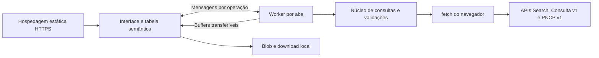

# Arquitetura e organização do código

O Contratos Web é uma aplicação estática. Um Web Worker por aba valida entradas, consulta diretamente as APIs do PNCP e gera CSV. O tema é aplicado por um boot mínimo antes da primeira pintura e um Service Worker opcional mantém os assets com hash em cache. A hospedagem entrega os arquivos compilados; Node.js, Vite e Playwright são ferramentas de desenvolvimento, build e testes.

## Decisões de arquitetura

Cada decisão registra o contexto, a escolha e suas consequências. Novas decisões devem seguir o mesmo formato.

### D1. Aplicação estática, sem backend

- **Contexto:** os dados são públicos e o PNCP aceita CORS para leitura.
- **Decisão:** o navegador consulta o PNCP diretamente; a hospedagem só entrega arquivos.
- **Consequências:** custo e superfície de ataque mínimos e nenhum dado de usuário no servidor. Em troca, ritmo e concorrência são por aba, não há cache compartilhado entre usuários e CORS, TLS e disponibilidade dependem da fonte.

### D2. Consultas num Web Worker

- **Contexto:** a projeção de páginas, a validação e a geração de CSV de até 10.000 documentos travariam a interface.
- **Decisão:** um Worker por aba executa validação, rede e CSV; a interface conversa por mensagens com ID, versão de protocolo e cancelamento.
- **Consequências:** a interface continua responsiva e os buffers do CSV são transferidos sem cópia. O Worker é criado logo no início, em paralelo ao download da configuração, para não alongar a inicialização.

### D3. Parser JSON com números exatos

- **Contexto:** valores monetários e identificadores do PNCP perdem precisão em `number`.
- **Decisão:** `parseExactJson` preserva o texto de cada número e só converte inteiros seguros.
- **Consequências:** valores e CSV mantêm a representação da fonte; o parser é código próprio e tem corpus de testes dedicado.

### D4. Ritmo, fila e prioridade compartilhados

- **Contexto:** a fonte limita requisições (HTTP 429) e uma aba pode disparar pesquisa, pré-carga, painéis e CSV ao mesmo tempo.
- **Decisão:** um único cliente por Worker impõe concorrência e chamadas por segundo, dá prioridade ao primeiro plano e respeita `Retry-After`. Operações excedentes aguardam numa fila FIFO do Worker; só uma fila anormalmente longa devolve `CONCURRENCY_LIMIT`.
- **Consequências:** o uso é previsível e não depende de qual módulo chamou. A exportação mantém até duas páginas adiantadas para ficar limitada pelo ritmo, não pela latência.

### D5. Domínios validados no Worker e reutilizados

- **Contexto:** filtros de lista fechada precisam de IDs válidos, e as listas são grandes.
- **Decisão:** o Worker valida os IDs antes de pesquisar ou exportar. A pré-carga da interface e a validação usam o mesmo cache de 4 horas e compartilham a requisição em andamento; a interface também persiste as listas no `localStorage`/IndexedDB.
- **Consequências:** nenhuma requisição duplicada de `/filters` na mesma aba. O cache do Worker é reconstruído a cada recarga.

### D6. Sem framework nem dependências de produção

- **Contexto:** a interface é uma página única, com poucos componentes e orçamento de tamanho rígido.
- **Decisão:** módulos ES com DOM nativo, `<dialog>`, `popover` e componentes próprios (tabela, paginação, seletores).
- **Consequências:** bundle pequeno, CSP restritiva e nenhuma atualização de dependência em produção. Em troca, acessibilidade e estados dos componentes são mantidos pelo projeto e cobertos por testes de navegador com axe.

### D7. Service Worker só para assets com hash

- **Contexto:** o GitHub Pages envia `Cache-Control: max-age=600` para todos os arquivos e ignora `_headers`.
- **Decisão:** o Service Worker mantém apenas `/assets/*` (nomes com hash) e não intercepta HTML, configuração nem o PNCP.
- **Consequências:** visitas repetidas não baixam os bundles de novo e não há risco de servir dados desatualizados; não há modo offline.

### D8. Estado compartilhado com dono explícito

- **Contexto:** os painéis precisam ler a consulta e o esquema da aplicação.
- **Decisão:** um único objeto `state` é passado aos módulos, mas cada campo tem um dono que o altera (comentário em `public/app.js`): `app.js` cuida da consulta e dos resultados; `filters-panel.js` do rascunho e dos domínios, reiniciados por `filters.reset()`; `details-panel.js` da seleção, reiniciada por `details.close()`.
- **Consequências:** os demais módulos só leem esses campos; mudanças de responsabilidade devem atualizar o comentário e esta seção.

## Componentes

| Arquivo | Responsabilidade |
| --- | --- |
| [`src/settings.js`](../src/settings.js) | Padrões e validação de configuração portável; whitelist pública |
| [`src/operation.js`](../src/operation.js) | Operações, cancelamento, prazo absoluto e contadores de recursos |
| [`src/validation.js`](../src/validation.js) | Consultas, filtros, domínios, sugestões, identidades e paginação; valida antes da rede no Worker |
| [`src/schema.js`](../src/schema.js), [`src/pncp-arguments.json`](../src/pncp-arguments.json) e [`src/filter-domains.js`](../src/filter-domains.js) | Colunas, 80 filtros, compatibilidade documental, domínios e apresentação; o build remove as descrições do catálogo de argumentos, que só documentam o repositório |
| [`src/pncp-core.js`](../src/pncp-core.js) | Serialização, fila, ritmo, tentativas, leitura incremental, normalização e caminhos PNCP |
| [`src/exact-json.js`](../src/exact-json.js) | Parser JSON com pilha explícita, validação da gramática e representação exata dos números |
| [`src/query-core.js`](../src/query-core.js) | Pesquisa, validação de domínios, metadados, detalhes e coleta por páginas |
| [`src/csv.js`](../src/csv.js) | Codificação UTF-8 com BOM, CRLF, escape e orçamento por byte |
| [`src/adapter.js`](../src/adapter.js), [`src/related.js`](../src/related.js), [`src/document-details.js`](../src/document-details.js) | Projeções, precisão, identidades e links seguros para os três tipos e registros filhos |
| [`src/browser/client.js`](../src/browser/client.js) | Configuração pública e transporte fetch nativo sem credenciais |
| [`src/browser/runtime.js`](../src/browser/runtime.js), [`worker.js`](../src/browser/worker.js) | Serviço no Worker, métodos permitidos, operações, progresso, erros serializados e buffers transferíveis |
| [`src/browser/service.js`](../src/browser/service.js), [`protocol.js`](../src/browser/protocol.js) | Ponte por ID, versão, cancelamento local, descarte de respostas tardias e recuperação de falha |
| [`src/browser/filter-options-cache.js`](../src/browser/filter-options-cache.js), [`options-db.js`](../src/browser/options-db.js) | Pré-carregamento dos domínios dos três tipos, cache local com validade de 4 horas, deduplicação, opções dependentes de normativos e fallback em IndexedDB quando o `localStorage` não está disponível |
| [`src/browser/filter-label-cache.js`](../src/browser/filter-label-cache.js) | Nomes de opções selecionadas, persistidos por tipo documental, campo e ID para restaurar a apresentação após recarregar |
| [`src/browser/recent-filter-options.js`](../src/browser/recent-filter-options.js) | Opções escolhidas recentemente nos campos com sugestão, por campo, mostradas antes da busca de três caracteres |
| [`public/municipality-catalog.js`](../public/municipality-catalog.js), [`municipios-ibge.json`](../public/municipios-ibge.json) | Relação de municípios do IBGE carregada sob demanda, busca local e rótulos `Município/UF` dos filtros por código IBGE |
| [`src/browser/query-url.js`](../src/browser/query-url.js) | Leitura e escrita de parâmetros GET, conversão de filtros tipados e validação compartilhada de links de pesquisa |
| [`src/browser/detail-url.js`](../src/browser/detail-url.js) | Identidade documental e aba nos parâmetros GET, com validação por tipo de documento |
| [`public/app.js`](../public/app.js) | Interface inicializada com serviço e tabela injetáveis; consultas, DOM, histórico da URL e download |
| [`public/filters-panel.js`](../public/filters-panel.js) | Modal de filtros: rascunho, editores de domínio, sugestões, amparos por normativo e critérios aplicados |
| [`public/details-panel.js`](../public/details-panel.js) | Seleção do documento em detalhe, abas, itens e listagens vinculadas, com paginação, cancelamento e descarte de respostas antigas |
| [`public/item-results.js`](../public/item-results.js) | Resultado homologado dos itens: preço, comparação exata com o estimado e fornecedor sem CPF |
| [`public/format.js`](../public/format.js) | Formatação de datas, quantidades e valores; células da tabela e classes de situação |
| [`public/tooltips.js`](../public/tooltips.js) | Tooltips da barra de ferramentas e do aviso de janela de resultados |
| [`public/search-help.js`](../public/search-help.js), [`search-library.js`](../public/search-library.js), [`search-presets.json`](../public/search-presets.json) | Popover de buscas prontas (carregadas do JSON ao abrir), buscas salvas no navegador e dicas com os operadores do PNCP |
| [`public/column-layout.js`](../public/column-layout.js) | Persistência de visibilidade, ordem e largura das colunas por tipo documental |
| [`public/session.js`](../public/session.js) | Contadores de operação por tipo; um token novo invalida respostas pendentes do token anterior |
| [`public/results-table.js`](../public/results-table.js), [`results-table.css`](../public/results-table.css) | Tabela semântica, cartões móveis, menus, visibilidade, ordem e largura de colunas |
| [`public/pagination.js`](../public/pagination.js), [`pagination.css`](../public/pagination.css) | Paginação compartilhada entre resultados e detalhes; números, limites, foco, carregamento e modo sem total conhecido |
| [`public/mobile-layout.js`](../public/mobile-layout.js), [`mobile.css`](../public/mobile.css) | Cabeçalho móvel, ações em popover, adaptação ao viewport visível, áreas seguras e painéis responsivos |
| [`public/select-menu.js`](../public/select-menu.js), [`select-menu.css`](../public/select-menu.css) | Seletores simples com combobox/listbox, menus em popover, teclado, temas e sincronização dos valores nativos |
| [`public/browser-entry.js`](../public/browser-entry.js) | Configuração pública e inicialização da distribuição estática |
| [`public/theme-boot.js`](../public/theme-boot.js), [`theme.js`](../public/theme.js), [`theme.css`](../public/theme.css) | Tema aplicado antes da primeira pintura (`theme-boot.js` é embutido no HTML pelo build, autorizado na CSP por hash), preferência, integração com o sistema, sincronização entre abas e paleta escura |
| [`public/sw.js`](../public/sw.js) | Cache de assets com hash em HTTPS, sem interceptar HTML, configuração ou chamadas ao PNCP |
| [`vite.config.js`](../vite.config.js) | Aplicação e diagnóstico, Worker ES module, assets relativos, CSP e saída `dist-browser/` |
| [`test/`](../test/) | Núcleo, DOM, runtime/RPC, layout, acessibilidade com axe e build estático no navegador |

Vite, Playwright, ESLint e Prettier são ferramentas de desenvolvimento. O ESLint é executado na validação e não participa da distribuição; o Prettier formata `src/`, `public/`, `test/` e `types/` e é conferido no CI (`npm run format:check`). A aplicação não tem dependências de produção, CDN, imports de pacote pendentes ou polyfills de Node.js na distribuição estática.

`state.query` é a fonte única dos critérios: `updateCriteria` projeta a consulta nos controles do cabeçalho, e a interface só relê os campos ao pesquisar. Os contadores de operação ficam em `session.js`; cada módulo recebe o mesmo registro e invalida respostas antigas com um token novo, sem campos de sequência espalhados pelo estado.

## Serviço e fluxo de dados

A interface usa `service.call(method, payload, {signal, onProgress})`. A ponte do navegador confirma a versão e envia `{id, method, payload}` ao Worker. Cada resultado, erro ou progresso pertence ao mesmo ID. O `AbortSignal` permanece na interface e seu evento gera uma mensagem de cancelamento. Dados projetados são objetos simples; decimais e identificadores preservam a representação textual exata.

Os métodos são `schema`, `execute`, `domains`, `suggest`, `details`, `itemResults`, `related`, `documentDetails`, `documentRelated`, `contractChild` e `export`. Métodos e campos desconhecidos são rejeitados. Operações acima de `PNCP_MAX_CONCURRENT_OPERATIONS` aguardam na fila do Worker e podem ser canceladas antes de iniciar. Se o Worker falhar, todas as promessas pendentes são rejeitadas; a próxima chamada inicializa um novo Worker. O descarte da página encerra o Worker. Fechar um painel cancela suas operações sem encerrar as demais.

A inicialização obtém o esquema e configura colunas e filtros. O Worker valida os critérios e domínios fechados antes de consultar a fonte, reutilizando por quatro horas as opções já consultadas, inclusive pela pré-carga da interface, e compartilhando requisições em andamento. Cada troca de página faz nova chamada, reutilizando em memória por 30 segundos páginas já visitadas da mesma consulta sem o registro bruto dos editais; ao abrir um documento vindo desse cache, os detalhes completos são consultados na fonte. A fila compartilha concorrência e ritmo entre pesquisa, domínios, painéis e CSV, e operações de primeiro plano passam à frente da pré-carga em segundo plano. A espera entre retentativas libera a vaga de concorrência antes de aguardar, permitindo que outras operações avancem; HTTP 429 continua impondo a pausa compartilhada. O limitador libera o início de cada chamada no instante de envio: esperas canceladas não acumulam atraso, e HTTP 429 atualiza a espera compartilhada, inclusive para operações já enfileiradas. O leitor contabiliza bytes, decodifica o corpo com `TextDecoder` e interpreta JSON com `parseExactJson`. A pesquisa confere tipo documental, total e quantidade de registros antes da projeção.

O parser preserva o token numérico em `ExactJsonNumber`, sem conversão intermediária para ponto flutuante. Objetos e arrays usam uma pilha explícita; strings têm seus escapes decodificados pelo `JSON.parse` nativo. Chaves repetidas com valores equivalentes são aceitas e conflitos produzem erro. Propriedades como `__proto__` são tratadas como dados. A marca do tipo numérico é interna e não pode ser simulada por um objeto do JSON. `scalarText` e `decimalText` preservam dígitos e casas decimais; `plain` normaliza iterativamente os dados e converte somente inteiros seguros para números. Instâncias internas não atravessam o RPC. Configuração e cache já normalizados continuam usando `JSON.parse`.

Após receber o esquema, a interface inicia em segundo plano os três domínios de busca, os quatro catálogos auxiliares compartilhados e a enumeração de referência. A pré-carga é sequencial, usa prioridade `background` na fila e não espera para inicializar a tabela. O painel reutiliza essas listas, deduplicando chamadas pendentes; fechar os filtros cancela a espera daquele leitor, sem interromper o carregamento compartilhado. Sugestões por texto continuam consultando a fonte; a conferência de domínios fechados antes da pesquisa/CSV reutiliza por quatro horas as opções já validadas no Worker.

Critérios novos começam na primeira página; Atualizar preserva os últimos critérios concluídos e a página. Respostas antigas são descartadas. Falhas identificam e preservam o resultado anterior e desabilitam exportação até a pesquisa concluir novamente.

Antes da primeira consulta, a interface lê a URL e configura tipo documental, colunas, texto, status, filtros, ordenação, página e eventual documento/aba do painel de detalhes. Uma URL inválida mostra um aviso sem executar a busca. Consultas iniciadas, abertura/fechamento do painel e seleção de abas sincronizam os parâmetros com `history.pushState`, preservando caminho, fragmento e parâmetros externos. Inicialização e `popstate` usam `replaceState` para normalizar a URL sem duplicar entradas. Voltar/Avançar restauram a consulta e o painel; só repetem a pesquisa quando seus critérios ou página mudam. Trocar de aba no mesmo documento reutiliza os dados carregados. Rascunhos de filtros não alteram o link.

`detalhe` contém tipo, CNPJ, ano e sequencial nativos; atas também incluem o sequencial da compra. `aba` identifica uma seção compatível com esse tipo. A restauração reutiliza uma linha disponível ou cria uma identificação provisória e consulta `documentDetails`, inclusive para editais. Se os detalhes nativos falharem, a interface reutiliza os dados da busca e oferece nova tentativa. Os campos de edital usam `/api/consulta/v1`; atas, contratos e listagens usam `/api/pncp/v1`. O painel e a busca carregam independentemente: o documento não precisa constar nos resultados, e uma falha da busca não impede seus detalhes. Fechar, trocar o documento ou iniciar nova busca cancela as operações do painel; respostas antigas não mudam a seleção atual.

A paginação remota usa `loadResultsPage` para abrir diretamente a página do link. O seletor de ordenação usa `orders_by_document` e `order_labels` do esquema; o Worker e a leitura da URL validam a mesma compatibilidade. O seletor e os menus de colunas enviam critérios nativos ao PNCP, sem ordenação ou filtragem local. Novos critérios reiniciam a página. Atualizar consulta a página da última pesquisa concluída; repetir uma falha usa a página que falhou.

Os comportamentos detalhados da interface (filtros, seletores, temas, tabela e painéis) estão em [Comportamento da interface](interface.md).

## CSV e recursos

O botão **Exportar** abre um menu com as opções **Toda a consulta** e **Página atual**. Qualquer escopo inicia uma nova coleta com os últimos critérios concluídos, desde a primeira página, ou somente da página atual quando esse escopo é escolhido. A coleta completa usa `PNCP_EXPORT_PAGE_SIZE` (100 por padrão); o escopo **Página atual** preserva `query.page` e `query.size`, independentemente dessa configuração. Até duas páginas seguintes ficam solicitadas enquanto a atual é codificada. Cada página confere total, tamanho e identidade; duplicação ou alteração encerra a operação. O Worker projeta uma página e codifica lotes de 25 documentos, devolvendo controle ao loop de eventos entre lotes/páginas. Mantém chunks de bytes e um conjunto de identidades. O resultado contém bytes e metadados compactos.

Progresso contém páginas, linhas, total e bytes. Só a coleta completa transfere os `ArrayBuffer` à interface, junto de nome, MIME e metadados compactos. A interface cria o Blob e revoga a URL após o download. Não há download parcial. Campos textuais que poderiam ser interpretados como fórmulas recebem um apóstrofo antes do conteúdo; valores decimais válidos, inclusive negativos, mantêm sua representação exata. `snapshot_guaranteed` é `false`, pois o PNCP pode mudar entre chamadas.

## Persistência e segurança

Estado de consultas, fila, contadores e resultados de pesquisa, detalhes e CSV são transitórios. Além da preferência de tema, o `localStorage` armazena listas normalizadas de opções e seus metadados de apresentação, sob o prefixo `contratos-web:filter-options:v1:`, separadas por fonte, versão do esquema e contexto. A validade é de 4 horas desde o carregamento bem-sucedido; a inicialização e cada uso descartam entradas vencidas, corrompidas, com data futura ou com aviso de omissão de anos, sem limpar dados alheios. As opções de ano preservam os valores fornecidos pelo PNCP, inclusive fora do formato `AAAA`. Leituras não prolongam a validade. Amparos legais têm entradas por tipo e conjunto de normativos.

Os nomes das opções selecionadas são metadados separados das listas de opções: `filter-label-cache.js` guarda até mil rótulos recentes no `localStorage`, na chave `contratos-web:filter-labels:v1`. Assim, órgão, unidade e outros campos de sugestão mantêm seus nomes após recarregar, mesmo quando o ID não aparece na lista inicial. Esse histórico não expira junto dos catálogos de quatro horas e é atualizado ao selecionar novamente a opção. Registros inválidos são descartados; armazenamento indisponível mantém apenas a sessão. Sem cache, os IDs de Órgão e Unidade são conferidos nos resultados da pesquisa; quando necessário, consultas separadas restritas a cada ID recuperam os nomes em segundo plano. Os rótulos só são associados quando o ID retornado corresponde ao solicitado. Falhas preservam os IDs e permitem nova tentativa ao atualizar. Consultas e URLs continuam usando os IDs, sem nomes adicionais.

Listas com JSON a partir de 65.536 caracteres são compactadas com `CompressionStream('gzip')` e armazenadas em base64, mantendo opções, IDs, rótulos, estados e metadados. A leitura aceita JSON ou gzip/base64 e usa `DecompressionStream` no segundo caso. A pré-carga processa cada entrada antes da próxima. Conteúdo inválido é descartado e recarregado.

Falhas não são armazenadas e não impedem a pré-carga das demais listas. Armazenamento bloqueado ou sem quota usa IndexedDB quando disponível e, em último caso, mantém o cache em memória com a mesma validade. O IndexedDB só confirma leituras ou escritas após a conclusão da transação; abortos e erros rejeitam a operação para liberar a fila e permitir o fallback em memória. Conexões tardias após abertura bloqueada e conexões substituídas por outra versão são fechadas. Sem as APIs nativas de compactação, o navegador mantém o formato JSON. Novas abas podem reutilizar entradas persistidas na mesma origem, mas não há coordenação de chamadas concorrentes entre abas. Resultados de pesquisa ficam apenas em memória por 30 segundos e não sobrevivem ao recarregamento. Um Service Worker opcional, registrado somente em HTTPS, mantém assets com hash em cache; ele não intercepta HTML, `browser-config.json`, a API do PNCP nem dados de pesquisa. Não há backend, login nem consultas reais offline. A suíte usa dados sintéticos próprios, isolados do código de distribuição.

A configuração estática só aceita chaves públicas e bases fixas do PNCP. Consultas nativas são GET com CORS, sem credenciais, com `cache: no-store` no transporte HTTP e sem seguir redirecionamentos; o cache de opções é controlado pela aplicação. TLS e CORS são controles do navegador e da fonte; a aplicação não os contorna. A CSP permite conexões PNCP e Worker da própria origem. Textos da fonte são exibidos como texto, e links são validados.

O artefato usa assets com hash e caminhos relativos para raiz/subdiretório. Cabeçalhos, atualização e diagnóstico na origem publicada estão em [Hospedagem estática](hospedagem-estatica.md). Os testes e seu alcance estão em [Validação](validacao.md).
