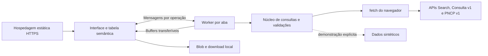

# Arquitetura e organização do código

O Contratos Web é uma aplicação estática. Um Web Worker por aba valida entradas, consulta diretamente as APIs do PNCP e gera CSV. A hospedagem entrega os arquivos compilados; Node.js, Vite e Playwright são ferramentas de desenvolvimento, build e testes.

## Componentes

| Arquivo | Responsabilidade |
| --- | --- |
| [`src/settings.js`](../src/settings.js) | Padrões e validação de configuração portável; whitelist pública |
| [`src/operation.js`](../src/operation.js) | Operações, cancelamento, prazo absoluto e contadores de recursos |
| [`src/validation.js`](../src/validation.js) | Consultas, filtros, domínios, sugestões, identidades e paginação; valida antes da rede no Worker |
| [`src/schema.js`](../src/schema.js), [`src/pncp-arguments.json`](../src/pncp-arguments.json) e [`src/filter-domains.js`](../src/filter-domains.js) | Colunas, 80 filtros, compatibilidade documental, domínios e apresentação |
| [`src/pncp-core.js`](../src/pncp-core.js) | Serialização, fila, ritmo, tentativas, leitura incremental, normalização e caminhos PNCP |
| [`src/exact-json.js`](../src/exact-json.js) | Parser JSON com pilha explícita, validação da gramática e representação exata dos números |
| [`src/query-core.js`](../src/query-core.js) | Pesquisa, validação de domínios, metadados, detalhes e coleta por páginas |
| [`src/csv.js`](../src/csv.js) | Codificação UTF-8 com BOM, CRLF, escape e orçamento por byte |
| [`src/adapter.js`](../src/adapter.js), [`src/related.js`](../src/related.js), [`src/document-details.js`](../src/document-details.js) | Projeções, precisão, identidades e links seguros para os três tipos e registros filhos |
| [`src/browser/client.js`](../src/browser/client.js) | Configuração pública e transporte fetch nativo sem credenciais |
| [`src/browser/runtime.js`](../src/browser/runtime.js), [`worker.js`](../src/browser/worker.js) | Serviço no Worker, métodos permitidos, operações, progresso, erros serializados e buffers transferíveis |
| [`src/browser/service.js`](../src/browser/service.js), [`protocol.js`](../src/browser/protocol.js) | Ponte por ID, versão, cancelamento local, descarte de respostas tardias e recuperação de falha |
| [`src/browser/filter-options-cache.js`](../src/browser/filter-options-cache.js) | Pré-carregamento dos domínios dos três tipos, cache local com validade de 4 horas, deduplicação e opções dependentes de normativos |
| [`src/browser/query-url.js`](../src/browser/query-url.js) | Leitura e escrita de parâmetros GET, conversão de filtros tipados e validação compartilhada de links de pesquisa |
| [`src/browser/detail-url.js`](../src/browser/detail-url.js) | Identidade documental e aba nos parâmetros GET, com validação por tipo de documento |
| [`public/app.js`](../public/app.js) | Interface inicializada com serviço e tabela injetáveis; consultas, DOM, histórico da URL, painéis e download |
| [`public/results-table.js`](../public/results-table.js), [`results-table.css`](../public/results-table.css) | Tabela semântica, cartões móveis, menus, visibilidade, ordem e largura de colunas |
| [`public/pagination.js`](../public/pagination.js), [`pagination.css`](../public/pagination.css) | Paginação compartilhada entre resultados e detalhes; números, limites, foco, carregamento e modo sem total conhecido |
| [`public/mobile-layout.js`](../public/mobile-layout.js), [`mobile.css`](../public/mobile.css) | Cabeçalho móvel, ações em popover, adaptação ao viewport visível, áreas seguras e painéis responsivos |
| [`public/select-menu.js`](../public/select-menu.js), [`select-menu.css`](../public/select-menu.css) | Seletores simples com combobox/listbox, menus em popover, teclado, temas e sincronização dos valores nativos |
| [`public/browser-entry.js`](../public/browser-entry.js) | Configuração pública e inicialização da distribuição estática |
| [`public/theme.js`](../public/theme.js), [`theme.css`](../public/theme.css) | Preferência de tema, integração com o sistema, sincronização entre abas e paleta escura |
| [`src/demo.js`](../src/demo.js) | Fonte fictícia escolhida explicitamente |
| [`vite.config.js`](../vite.config.js) | Aplicação e diagnóstico, Worker ES module, assets relativos, CSP e saída `dist-browser/` |
| [`test/`](../test/) | Núcleo, DOM, runtime/RPC, layout e build estático no navegador |

Vite e Playwright são ferramentas de desenvolvimento. A aplicação não tem dependências de produção, CDN, imports de pacote pendentes ou polyfills de Node.js na distribuição estática.

## Serviço e fluxo de dados

A interface usa `service.call(method, payload, {signal, onProgress})`. A ponte do navegador confirma a versão e envia `{id, method, payload}` ao Worker. Cada resultado, erro ou progresso pertence ao mesmo ID. O `AbortSignal` permanece na interface e seu evento gera uma mensagem de cancelamento. Dados projetados são objetos simples; decimais e identificadores preservam a representação textual exata.

Os métodos são `schema`, `execute`, `domains`, `suggest`, `details`, `related`, `documentDetails`, `documentRelated`, `contractChild` e `export`. Métodos e campos desconhecidos são rejeitados. Se o Worker falhar, todas as promessas pendentes são rejeitadas; a próxima chamada inicializa um novo Worker. O descarte da página encerra o Worker. Fechar um painel cancela suas operações sem encerrar as demais.

A inicialização obtém o esquema e configura colunas e filtros. O Worker valida os critérios e domínios fechados antes de consultar a fonte. Cada troca de página faz nova chamada. A fila compartilha concorrência e ritmo entre pesquisa, domínios, painéis e CSV. O leitor contabiliza bytes, decodifica o corpo com `TextDecoder` e interpreta JSON com `parseExactJson`. A pesquisa confere tipo documental, total e quantidade de registros antes da projeção.

O parser preserva o token numérico em `ExactJsonNumber`, sem conversão intermediária para ponto flutuante. Objetos e arrays usam uma pilha explícita; strings têm seus escapes decodificados pelo `JSON.parse` nativo. Chaves repetidas com valores equivalentes são aceitas e conflitos produzem erro. Propriedades como `__proto__` são tratadas como dados. A marca do tipo numérico é interna e não pode ser simulada por um objeto do JSON. `scalarText` e `decimalText` preservam dígitos e casas decimais; `plain` normaliza iterativamente os dados e converte somente inteiros seguros para números. Instâncias internas não atravessam o RPC. Configuração e cache já normalizados continuam usando `JSON.parse`.

Após receber o esquema, a interface inicia em segundo plano os três domínios de busca, os quatro catálogos auxiliares compartilhados e a enumeração de referência. A pré-carga é sequencial e não espera para inicializar a tabela. O painel reutiliza essas listas, deduplicando chamadas pendentes; fechar os filtros cancela a espera daquele leitor, sem interromper o carregamento compartilhado. Sugestões por texto e a conferência de domínios fechados antes da pesquisa/CSV continuam consultando a fonte.

O modal de filtros renderiza todos os campos habilitados e compatíveis com o tipo documental, agrupados por assunto. Cabeçalho e ações permanecem visíveis enquanto o conteúdo rola. Cada alteração atualiza somente o rascunho; **Aplicar e pesquisar** copia os critérios para a consulta, e cancelar os descarta. Booleanos e enumerações possuem o placeholder **Selecionar**, com valor vazio. Campos vazios e listas sem seleção removem critérios, preservando `false` e zero quando informados. Domínios parciais possuem seleção e sugestões independentes por campo, com descarte de respostas antigas. Alterar normativos atualiza os amparos mesmo quando ainda não há amparo selecionado.

Em até 700 px, o modal ocupa o viewport visível; os grupos de filtros ficam em uma área rolável, com cabeçalho e ações fixos. Os controles principais têm área de toque de pelo menos 44 px e os campos de texto usam 16 px. `visualViewport` acompanha a altura disponível e o deslocamento causados pelo teclado, sem redimensionar a interface durante zoom por gesto; `env(safe-area-inset-*)` reserva as áreas seguras do dispositivo.

Todos os filtros de cardinalidade múltipla usam comboboxes de busca, listas com marcação e etiquetas removíveis. Domínios completos usam as opções em cache e busca local sem distinção de acentos; domínios parciais mantêm as sugestões remotas. Os menus ficam no contêiner `filter-popups`, fora do conteúdo rolável, com posição fixa calculada a partir do campo. A rolagem atualiza essa posição ou fecha o menu se o campo sair da área visível. Apenas um menu permanece aberto; clique externo, perda de foco, Tab e Escape o fecham. As setas e Enter controlam a seleção, com vínculos ARIA entre combobox e listbox.

As ajudas de campos vêm de `help_text` no esquema e complementam os rótulos. Exemplos de preenchimento ficam somente no placeholder, via `input_hint`, incluindo os limites de ordem de classificação. Datas vazias e os demais placeholders usam a mesma cor semântica do tema; datas preenchidas usam a cor normal do texto. Descrições técnicas de argumentos não são exibidas como ajuda. A orientação sobre filtros de itens, resultados e fornecedores aparece uma vez, na seção de itens.

`initializeSelectMenus` aplica uma apresentação comum aos selects simples, incluindo controles criados nos filtros e detalhes. O select original conserva valor, eventos, integração com formulários e tamanho intrínseco; fica transparente, fora da navegação por Tab e da árvore acessível. Um botão com papel `combobox` assume o rótulo e os estados, e uma `listbox` em popover nativo exibe opções como texto, a marca de seleção e o destaque de navegação. Rótulos apontam para o novo controle. Nenhuma dependência é adicionada.

Setas, Home/End e busca pelas primeiras letras movem o destaque sem alterar o valor. Enter/Espaço confirma e emite `input`/`change` quando a escolha muda; Escape, Tab, perda de foco e clique externo descartam a navegação. Opções ocultas são omitidas e opções desabilitadas não podem ser escolhidas. Os menus ajustam largura, altura e posição ao viewport visível, abrem acima quando falta espaço abaixo e acompanham a rolagem ou fecham quando o controle sai de vista. Dentro de diálogos e do menu Mais, permanecem na camada superior e no contexto do controle.

Acima de 700 px, menus de seleção simples e múltipla usam transições de opacidade de 160 ms; os modais de filtros e colunas e seus fundos usam 200 ms. O painel de detalhes usa deslizamento de 240 ms. As transições preservam a geometria usada no alinhamento dos menus. `display` e `overlay`, com `allow-discrete` e `@starting-style`, mantêm o conteúdo renderizado até o fim do fechamento. Elementos em fechamento não interceptam cliques, e o modal de filtros conserva a disposição em coluna durante a saída. No mobile, abertura e fechamento continuam imediatos.

Um `MutationObserver` acompanha opções, rótulos e estados atualizados em segundo plano. Alterações programáticas de valor na aplicação chamam `refresh`; eventos dos controles nativos e reset de formulário também atualizam a apresentação. Atualizar o texto de opções preserva o destaque em navegação. Controles removidos são descartados; no encerramento da página, listeners e observadores são liberados. A retomada pelo cache de navegação mantém os controles.

Critérios novos começam na primeira página; Atualizar preserva os últimos critérios concluídos e a página. Respostas antigas são descartadas. Falhas identificam e preservam o resultado anterior e desabilitam exportação até a pesquisa concluir novamente.

Antes da primeira consulta, a interface lê a URL e configura tipo documental, colunas, texto, status, filtros, ordenação, página e eventual documento/aba do painel de detalhes. Uma URL inválida mostra um aviso sem executar a busca. Consultas iniciadas, abertura/fechamento do painel e seleção de abas sincronizam os parâmetros com `history.pushState`, preservando caminho, fragmento e parâmetros externos. Inicialização e `popstate` usam `replaceState` para normalizar a URL sem duplicar entradas. Voltar/Avançar restauram a consulta e o painel; só repetem a pesquisa quando seus critérios ou página mudam. Trocar de aba no mesmo documento reutiliza os dados carregados. Rascunhos de filtros não alteram o link.

`detalhe` contém tipo, CNPJ, ano e sequencial nativos; atas também incluem o sequencial da compra. `aba` identifica uma seção compatível com esse tipo. A restauração reutiliza uma linha disponível ou cria uma identificação provisória e consulta `documentDetails`, inclusive para editais. Os campos de edital usam `/api/consulta/v1`; atas, contratos e listagens usam `/api/pncp/v1`. O painel e a busca carregam independentemente: o documento não precisa constar nos resultados, e uma falha da busca não impede seus detalhes. Fechar, trocar o documento ou iniciar nova busca cancela as operações do painel; respostas antigas não mudam a seleção atual.

A paginação remota usa `loadResultsPage` para abrir diretamente a página do link. O seletor de ordenação usa `orders_by_document` e `order_labels` do esquema; o Worker e a leitura da URL validam a mesma compatibilidade. O seletor e os menus de colunas enviam critérios nativos ao PNCP, sem ordenação ou filtragem local. Novos critérios reiniciam a página. Atualizar consulta a página da última pesquisa concluída; repetir uma falha usa a página que falhou.

## Temas

O tema é aplicado por `theme.js`, carregado antes da inicialização das consultas. Sem preferência explícita, `prefers-color-scheme` define o tema e suas mudanças são acompanhadas. O botão de sol/lua salva `light` ou `dark` na chave `contratos-web:theme` do `localStorage`; a escolha prevalece sobre o sistema e eventos `storage` a sincronizam entre abas. Armazenamento indisponível não impede alternar o tema na página. A página de diagnóstico reutiliza a preferência.

`data-theme` no elemento raiz seleciona as cores semânticas de `theme.css` e `color-scheme` adapta os controles nativos e barras de rolagem. Os estilos da aplicação e da tabela mantêm os valores originais como alternativas do tema claro. Botões preenchidos têm cores próprias para conservar o contraste dos ícones brancos. O build preserva `blocking="render"` no módulo de entrada para aplicar o tema antes da primeira pintura nos navegadores que suportam esse atributo.

## Tabela de resultados

`createResultsTable` recebe colunas do esquema, o renderizador de células, o conteúdo do rodapé e callbacks de navegação, abertura de documentos e ações de coluna. A aplicação concentra as requisições, os abortos e a confirmação de resultados. `renderPage` aplica somente respostas atuais e concluídas; falhas e cancelamentos conservam linhas, metadados e página confirmados, enquanto a URL e a repetição identificam a consulta que falhou.

O componente usa `table`, `thead`, `tbody` e `colgroup`. Renderiza até 100 linhas da página e somente colunas visíveis, sem virtualização. O cabeçalho permanece fixo na rolagem vertical; rodapé e paginação ficam fora da área rolável. A paginação usa `last_page` do serviço e o componente compartilhado `createPagination`, com até cinco páginas numeradas e botões de primeira, anterior, próxima e última página. No celular, os controles ocupam toda a largura disponível. A busca mantém a janela de até cinco páginas; em detalhes com números longos e telas de até 400 px, a janela diminui para três páginas próximas à atual para conservar a legibilidade. O total real e o aviso da janela de 10.000 documentos pertencem ao rodapé da aplicação.

O callback opcional `renderCard` cria um resumo documental com texto e nós DOM; o componente mantém o acionamento de detalhes e renderiza cartões com os mesmos registros confirmados. Em até 700 px, cartões são a apresentação inicial. `setMobileView` alterna cartões/tabela em memória, sem pesquisar novamente ou alterar os critérios da URL. Acima desse limite, a tabela permanece visível. A seleção de colunas pertence à tabela e não remove os campos fixos dos cartões. A navegação de cartões e tabela usa o mesmo fluxo remoto de paginação.

`initializeMobileLayout` move as ações secundárias existentes, inclusive **Limpar filtros**, para o popover nativo **Mais** em até 700 px, conservando handlers, estados e nomes acessíveis. A marca fica oculta. A primeira linha contém busca, pesquisar e filtros; a segunda reúne tipo documental, ordenação e o ícone de **Mais**. Os seletores dividem igualmente o espaço restante da segunda linha, que ocupa toda a largura do cabeçalho. O ícone mantém área de toque de 44 px e nome acessível “Mais ações”; o popover abre abaixo dele, ajustado às bordas da tela. A ordem no DOM acompanha a disposição visual para navegação por teclado. Ao ampliar para desktop, os controles retornam às posições originais. O popover fecha ao executar uma ação, mudar a visualização, clicar fora ou pressionar Escape. Os listeners e marcadores são descartados com a página; a retomada pelo cache de navegação preserva os controles.

Linhas cujos valores visíveis não mudaram são reaproveitadas nas atualizações. A referência ao registro completo é atualizada mesmo nesse caso, para que a abertura de detalhes use os dados mais recentes. Alterações na definição das colunas invalidam essa renderização.

Visibilidade, ordem e larguras são mantidas em memória no tipo documental atual. Ao trocar o tipo, as definições padrão do esquema são reaplicadas. Pointer Events permitem mover e redimensionar colunas; Alt + setas move o título focado, e as setas/Home ajustam o controle de largura, com mínimo de 85 px. Menus têm foco, teclado, fechamento com Escape/clique externo e posição limitada ao viewport. O título do registro tem uma ação focável de detalhes, além do clique na linha. Seleção de texto e controles internos não ativam a linha. Conteúdo do PNCP é montado como texto e nós DOM.

Em colunas com apenas filtragem, o ícone abre o painel diretamente; “Filtrar por esta coluna” aparece como tooltip neutro ao passar o mouse ou focar o botão. Colunas que também permitem ordenação conservam o menu de ações. O painel posiciona o campo correspondente imediatamente, sem aguardar opções de outros filtros. Em intervalos, o foco vai ao limite inicial; quando as opções do campo ainda estão carregando, o foco fica no seu contêiner e passa ao campo assim que ele estiver pronto, desde que o usuário não tenha mudado de foco. Os critérios só são enviados ao clicar em **Aplicar e pesquisar**.

`setStatus` sinaliza carregamento e bloqueia interações; `clear` limpa os registros ao trocar o tipo. `destroy` encerra gestos, menus, listeners e observadores quando a página é descartada. A retomada pelo cache de navegação preserva o componente e o Worker.

## Painéis dos documentos

O cabeçalho do painel usa o título da linha selecionada. Contratações iniciam itens, arquivos, atas, contratos/empenhos e histórico em segundo plano. Atas iniciam detalhes completos, partes envolvidas, contratos, arquivos e histórico. Contratos iniciam detalhes completos, empenhos, instrumentos de cobrança, termos, arquivos e histórico. Uma fila do painel limita a duas tarefas ativas; abas preservam dados e paginação, contadores, teclado e recuperação independente. Itens e listagens usam dez registros por página, definidos em `DETAIL_PAGE_SIZE`, e reutilizam `createPagination`: com total conhecido, mostram até cinco páginas próximas à atual e os quatro atalhos; uma única página oculta o controle. Durante uma consulta, todos os botões ficam desabilitados. Falhas mantêm a página confirmada; a restauração de foco fica restrita à própria paginação.

A contagem de registros aparece após a listagem, alinhada à esquerda da paginação no desktop e acima dela no mobile. No desktop, o painel usa uma coluna flexível: cabeçalho, descrição e abas permanecem visíveis, e somente o conteúdo da aba selecionada tem rolagem interna.

O seletor móvel de seções, com nome acessível **Seção dos detalhes** e sem rótulo visível, e as abas usam a mesma função de ativação e os mesmos painéis. Opções acompanham contagens, erros e carregamento; a seção selecionada mantém o spinner durante a consulta. Selecionar uma opção sincroniza `aba` na URL sem refazer consultas. No layout móvel, `initializeMobileLayout` move os links **Abrir no PNCP** e **Sistema de origem** para o início de `details-content`: eles rolam junto da descrição e retornam ao cabeçalho no desktop. O conteúdo rola separado do título e do botão de fechar, que permanece disponível; abaixo de 401 px, os campos passam a uma coluna.

CNPJ, ano e sequenciais são textos validados. Atas preservam sequenciais da compra e da ata; contratos usam seu próprio sequencial. O detalhe completo confere controle PNCP contra a identidade antes de substituir os campos da busca. Falhas conservam os campos disponíveis.

Itens, arquivos, histórico e termos usam contagens separadas; outros recursos usam o total de envelopes paginados. Instrumentos de cobrança chegam numa lista sem paginação e usam `pagination_source: local_slice`. Arquivos de termos e detalhes de empenhos/instrumentos são consultados sob demanda. Arquivos binários permanecem como links seguros da fonte, sem coleta ao abrir o painel.

No histórico de contratos, a página é consultada mesmo quando a contagem declara zero ou menos páginas. Divergências preservam os eventos com `total` e `total_pages` nulos e `pagination_mode: until_empty`. A interface mantém esse modo durante a navegação no painel e o repassa ao Worker: próximas consultas ignoram a contagem e permitem avançar manualmente até uma página vazia, mesmo depois de páginas incompletas. A aba mostra `Histórico (?)` e **Quantidade desconhecida**; a paginação exibe apenas anterior, página atual e próxima, sem números de páginas adicionais nem atalhos de primeira/última. Contagens coerentes e todas as outras listagens conservam as verificações normais. HTTP de erro, registros inválidos e limites de transporte não são tratados como fim do histórico.

HTTP 404 significa zero nas listas de contratos vinculados a uma contratação e nas listas de empenhos e instrumentos de cobrança de um contrato. Outros 404, inclusive nos detalhes de registros individuais, continuam sendo erro. Listagens que admitem 204 preservam sua semântica, conferindo contagens quando disponíveis; a busca não converte 204 em vazio. Falha de transporte sem HTTP legível nunca vira zero.

## CSV e recursos

Exportar inicia uma nova coleta com os últimos critérios concluídos, desde a primeira página. O tamanho das páginas de coleta vem de `PNCP_PAGE_SIZE`. Cada página confere total, tamanho e identidade; duplicação ou alteração encerra a operação. O Worker projeta uma página e codifica lotes de 25 documentos, devolvendo controle ao loop de eventos entre lotes/páginas. Mantém chunks de bytes e um conjunto de identidades. O resultado contém bytes e metadados compactos.

Progresso contém páginas, linhas, total e bytes. Só a coleta completa transfere os `ArrayBuffer` à interface, junto de nome, MIME e metadados compactos. A interface cria o Blob e revoga a URL após o download. Não há download parcial. `snapshot_guaranteed` é `false`, pois o PNCP pode mudar entre chamadas.

## Persistência e segurança

Estado de consultas, fila, contadores e resultados de pesquisa, detalhes e CSV são transitórios. Além da preferência de tema, o `localStorage` armazena listas normalizadas de opções e seus metadados de apresentação, sob o prefixo `contratos-web:filter-options:v1:`, separadas por fonte, versão do esquema e contexto. A validade é de 4 horas desde o carregamento bem-sucedido; a inicialização e cada uso descartam entradas vencidas, corrompidas, com data futura ou com aviso de omissão de anos, sem limpar dados alheios. As opções de ano preservam os valores fornecidos pelo PNCP, inclusive fora do formato `AAAA`. Leituras não prolongam a validade. Amparos legais têm entradas por tipo e conjunto de normativos.

Listas com JSON a partir de 65.536 caracteres são compactadas com `CompressionStream('gzip')` e armazenadas em base64, mantendo opções, IDs, rótulos, estados e metadados. A leitura aceita JSON ou gzip/base64 e usa `DecompressionStream` no segundo caso. A pré-carga processa cada entrada antes da próxima. Conteúdo inválido é descartado e recarregado.

Falhas não são armazenadas e não impedem a pré-carga das demais listas. Armazenamento bloqueado ou sem quota mantém o cache em memória, com a mesma validade. Sem as APIs nativas de compactação, o navegador mantém o formato JSON e o fallback em memória se a quota for insuficiente. Novas abas podem reutilizar entradas persistidas na mesma origem, mas não há coordenação de chamadas concorrentes entre abas. Não há banco de dados, login, Service Worker nem consultas reais offline. A demonstração usa chaves separadas e nunca substitui automaticamente falhas reais.

A configuração estática só aceita chaves públicas e bases fixas do PNCP. Consultas nativas são GET com CORS, sem credenciais, com `cache: no-store` no transporte HTTP e sem seguir redirecionamentos; o cache de opções é controlado pela aplicação. TLS e CORS são controles do navegador e da fonte; a aplicação não os contorna. A CSP permite conexões PNCP e Worker da própria origem. Textos da fonte são exibidos como texto, e links são validados.

O artefato usa assets com hash e caminhos relativos para raiz/subdiretório. Cabeçalhos, atualização e diagnóstico na origem publicada estão em [Hospedagem estática](hospedagem-estatica.md). Os testes e seu alcance estão em [Validação](validacao.md).
